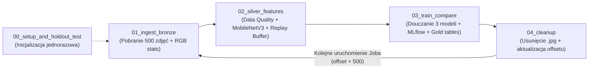

# Architektura potoku MLOps, Notebooki i Databricks Workflow Job

Projekt został zaprojektowany do uruchamiania bezpośrednio na platformie **Databricks** (z wykorzystaniem **Serverless Compute**, **Unity Catalog**, **Delta Lake**, **MLflow** oraz **Databricks Workflows**).

---

## 1. Struktura notebooków

Cały proces został podzielony na **5 modularnych notebooków** znajdujących się w katalogu [`notebooks/`](../notebooks/):

### Inicjalizacja (uruchamiana jednorazowo przed startem potoku)
- **[`00_setup_and_holdout_test.ipynb`](../notebooks/00_setup_and_holdout_test.ipynb)**
  - Tworzy wirtualny dysk (`Volume`) w Unity Catalog: `/Volumes/workspace/default/raw_data`.
  - Inicjalizuje tabelę stanu `pipeline_state` z wartością początkową `last_batch_id = 0` oraz `last_offset = 0`.
  - Pobiera ze strumienia testowego `500` zbalansowanych zdjęć (po `50` na każdą z `10` klas), ekstrahuje dla nich 576-wymiarowe wektory cech przez `MobileNetV3-Small` i zapisuje je w tabeli `silver_test_holdout`.

### Cykliczny potok przetwarzania paczek (Databricks Workflow Job)
1. **[`01_ingest_bronze_batch.ipynb`](../notebooks/01_ingest_bronze_batch.ipynb) – Warstwa Bronze (Ingestia)**
   - Odczytuje z `pipeline_state` aktualny `last_offset` oraz wyznacza numer bieżącej paczki (`current_batch_id = last_batch_id + 1`).
   - Pobiera strumieniowo `500` kolejnych zdjęć ze zbioru `giswqs/EuroSAT_RGB` (`train`).
   - Zapisuje fizyczne pliki `.jpg` w katalogu tymczasowym `/Volumes/workspace/default/raw_data/current_batch`.
   - Oblicza fizyczne statystyki każdego obrazu (wymiary `width`, `height`, średnie składowe `mean_r`, `mean_g`, `mean_b` oraz ogólną jasność `brightness`) i dopisuje rekordy do tabeli Delta `bronze_batch_stats`.
2. **[`02_silver_extract_features.ipynb`](../notebooks/02_silver_extract_features.ipynb) – Warstwa Silver (Walidacja i Ekstrakcja Cech)**
   - Pobiera listę zdjęć bieżącej paczki z `bronze_batch_stats` i wykonuje **kontrolę jakości danych (Data Quality)**:
     - weryfikuje fizyczną obecność i integralność pliku `.jpg`,
     - odrzuca obrazy uszkodzone, całkowicie czarne (`brightness < 5.0`) lub prześwietlone (`brightness > 250.0`).
   - Dla poprawnych zdjęć wykonuje ekstrakcję cech za pomocą zamrożonej sieci `MobileNetV3-Small` (paczkami po 64 obrazy), uzyskując wektor `576` cech (`features`).
   - Nadpisuje tabelę roboczą `silver_current_batch` wektorami bieżącej paczki.
   - Aktualizuje bufor pamięci **`silver_replay_buffer`** (losując do `30` nowych próbek z bieżącej paczki i utrzymując maksymalnie `100` wektorów historycznych).
3. **[`03_train_and_compare_mlflow.ipynb`](../notebooks/03_train_and_compare_mlflow.ipynb) – Warstwa Gold (Trening przyrostowy, MLflow i Ewaluacja)**
   - Łączy wektory z `silver_current_batch` z próbkami historycznymi z `silver_replay_buffer`.
   - Wczytuje wagi modeli z poprzedniej paczki (z katalogu `/Volumes/workspace/default/raw_data/model_checkpoints`) i doucza przyrostowo 3 klasyfikatory.
   - Ocenia każdy model na stałym zbiorze `silver_test_holdout` (`500` zdjęć).
   - Loguje parametry, metryki, czasy oraz checkpointy modeli do **MLflow** (`/Users/<email>/EuroSAT_Models_Comparison`).
   - Dopisuje zagregowane i jednostkowe wyniki ewaluacji do trzech tabel warstwy Gold: `gold_model_runs`, `gold_model_class_metrics` oraz `gold_model_predictions`.
4. **[`04_cleanup_batch.ipynb`](../notebooks/04_cleanup_batch.ipynb) – Czyszczenie i Aktualizacja Stanu**
   - Usuwa fizyczne pliki `.jpg` z `/Volumes/workspace/default/raw_data/current_batch`, zwalniając miejsce w Volume.
   - Czyści tabelę tymczasową `silver_current_batch` (`TRUNCATE TABLE`).
   - Dopisuje nowy wiersz do tabeli `pipeline_state` z ukończonym `completed_batch_id` oraz przesunięciem `new_offset = last_offset + 500`.

---

## 2. Konfiguracja Databricks Workflow Job

Cztery notebooki operacyjne (`01` → `02` → `03` → `04`) zostały połączone w sekwencyjny potok zadań (**DAG**) w usłudze **Databricks Workflows (Jobs)** uruchamiany na klastrze **Serverless**:

Każde pojedyncze uruchomienie Joba przetwarza kolejną porcję `500` zdjęć satelitarnych, doucza modele, zapisuje metryki w tabelach Gold i przygotowuje środowisko pod następną paczkę.

