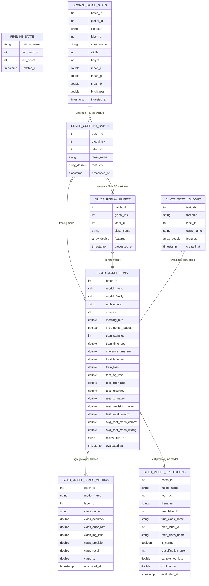

# Baza danych Unity Catalog (Medallion Architecture) i wyliczane wartości

Wszystkie tabele projektu przechowywane są w formacie **Delta Lake** w katalogu i schemacie zdefiniowanym w [`config.yaml`](../config.yaml) (`workspace.default`). Architektura bazy danych realizuje wzorzec **Medallion (Bronze → Silver → Gold)** uzupełniony o tabelę stanu potoku.

---

## 1. Tabela sterująca: `pipeline_state`

Przechowuje historię postępu strumieniowego pobierania zbioru danych.

| Kolumna | Typ | Opis wyliczanej wartości |
| :--- | :--- | :--- |
| `dataset_name` | `STRING` | Nazwa zbioru Hugging Face (`giswqs/EuroSAT_RGB`) |
| `last_batch_id` | `INT` | Numer ostatnio ukończonej paczki (`0` przy starcie, zwiększany o `1` po notebooku `04`) |
| `last_offset` | `INT` | Liczba przetworzonych dotychczas zdjęć treningowych (`last_offset + 500` po każdej paczce) |
| `updated_at` | `TIMESTAMP` | Znacznik czasu zapisu stanu (`current_timestamp()`) |

---

## 2. Warstwa Bronze: `bronze_batch_stats`

Przechowuje surowe metadane oraz fizyczne statystyki kolorystyczne każdego pobranego zdjęcia satelitarnego (tryb `append`).

| Kolumna | Typ | Opis i sposób wyliczenia |
| :--- | :--- | :--- |
| `batch_id` | `INT` | Numer paczki, w której pobrano zdjęcie |
| `global_idx` | `INT` | Globalny indeks zdjęcia w strumieniu treningowym (`current_offset + idx`) |
| `file_path` | `STRING` | Ścieżka tymczasowa do pliku `.jpg` w Volume |
| `label_id` | `INT` | Identyfikator klasy (`0–9`) |
| `class_name` | `STRING` | Nazwa klasy pokrycia terenu (np. `Forest`, `River`) |
| `width`, `height` | `INT` | Szerokość i wysokość obrazu w pikselach (`img.size`) |
| `mean_r` | `DOUBLE` | Średnia wartość kanału czerwonego (Red) ze wszystkich pikseli obrazu (`0–255`, zaokrąglona do 2 miejsc) |
| `mean_g` | `DOUBLE` | Średnia wartość kanału zielonego (Green) ze wszystkich pikseli obrazu (`0–255`) |
| `mean_b` | `DOUBLE` | Średnia wartość kanału niebieskiego (Blue) ze wszystkich pikseli obrazu (`0–255`) |
| `brightness` | `DOUBLE` | Średnia jasność obrazu liczona po wszystkich pikselach i kanałach RGB (`img_array.mean()`) |
| `ingested_at` | `TIMESTAMP` | Czas pobrania zdjęcia (`datetime.utcnow()`) |

---

## 3. Warstwa Silver: `silver_test_holdout`, `silver_current_batch`, `silver_replay_buffer`

Warstwa Silver przechowuje zwalidowane rekordy wraz z wyekstrahowanymi wektorami cech obrazu:

- **`silver_test_holdout`** (`500` rekordów, tryb `overwrite` przy inicjalizacji) – stały, zbalansowany zbiór testowy (po 50 zdjęć na klasę).
- **`silver_current_batch`** (do `500` rekordów, czyszczona w kroku `04`) – wektory cech bieżącej paczki po przejściu kontroli jakości (`5.0 <= brightness <= 250.0` oraz poprawny odczyt pliku).
- **`silver_replay_buffer`** (do `100` rekordów, tryb `overwrite`) – bufor pamięci przechowujący losową próbkę wektorów z dotychczasowych paczek.

| Kolumna | Typ | Opis wyliczanej wartości |
| :--- | :--- | :--- |
| `batch_id` / `test_idx` | `INT` | Numer paczki (w tabelach treningowych) lub indeks testowy `0–499` (w `silver_test_holdout`) |
| `global_idx` / `filename` | `INT` / `STRING` | Globalny indeks obrazu treningowego lub nazwa pliku testowego |
| `label_id` | `INT` | Identyfikator klasy (`0–9`) |
| `class_name` | `STRING` | Nazwa klasy pokrycia terenu |
| `features` | `ARRAY<DOUBLE>` | **Wektor 576 cech zmiennoprzecinkowych** wygenerowany przez zamrożoną sieć `MobileNetV3-Small` |
| `processed_at` / `created_at` | `TIMESTAMP` | Czas ekstrakcji cech |

---

## 4. Warstwa Gold: 3 tabele analityczne (zapis w trybie `append`)

### 4.1. `gold_model_runs` – Ogólne metryki, czasy i błędy każdego modelu po każdej paczce
Każdy przebieg dopisuje 3 wiersze (po jednym dla każdego z 3 porównywanych modeli).

| Kolumna | Typ | Opis i sposób wyliczenia |
| :--- | :--- | :--- |
| `batch_id` | `INT` | Numer paczki treningowej |
| `model_name` | `STRING` | Nazwa modelu (`PyTorch_Linear_Head`, `PyTorch_Deep_MLP`, `Sklearn_SGD_LogReg`) |
| `model_family` | `STRING` | Biblioteka (`PyTorch` lub `Scikit-Learn`) |
| `architecture` | `STRING` | Krótki opis architektury modelu |
| `epochs` | `INT` | Liczba epok treningowych na danej paczce |
| `learning_rate` | `DOUBLE` | Rzeczywisty współczynnik uczenia użyty w danej paczce |
| `incremental_loaded` | `BOOLEAN` | Czy model wczytał wagi z poprzedniej paczki (`True` od paczki `#2`) |
| `train_samples` | `INT` | Łączna liczba próbek uczących (bieżąca paczka + Replay Buffer) |
| `train_time_sec` | `DOUBLE` | Czas treningu modelu w sekundach |
| `inference_time_sec` | `DOUBLE` | Czas predykcji na `500` obrazach testowych w sekundach |
| `total_time_sec` | `DOUBLE` | Suma czasu treningu i inferencji (`train_time_sec + inference_time_sec`) |
| `train_loss` | `DOUBLE` | Średnia strata entropii krzyżowej (`CrossEntropyLoss` / `log_loss`) na zbiorze treningowym w ostatniej epoce |
| `test_log_loss` | `DOUBLE` | Średni błąd probabilistyczny (`log_loss`) na zbiorze testowym Holdout |
| `test_error_rate` | `DOUBLE` | Odsetek błędnych klasyfikacji na zbiorze testowym (`1.0 - test_accuracy`) |
| `test_accuracy` | `DOUBLE` | Dokładność klasyfikacji (`accuracy_score`) na `500` zdjęciach testowych |
| `test_f1_macro` | `DOUBLE` | Średnia makro miary F1 (`f1_score(..., average="macro")`) po 10 klasach |
| `test_precision_macro` | `DOUBLE` | Średnia makro precyzji (`precision_score(..., average="macro")`) |
| `test_recall_macro` | `DOUBLE` | Średnia makro czułości (`recall_score(..., average="macro")`) |
| `avg_conf_when_correct` | `DOUBLE` | Średnia pewność modelu ($\max p_i$) dla zdjęć sklasyfikowanych **poprawnie** |
| `avg_conf_when_wrong` | `DOUBLE` | Średnia pewność modelu ($\max p_i$) dla zdjęć sklasyfikowanych **błędnie** |
| `mlflow_run_id` | `STRING` | Identyfikator przebiegu w rejestrze eksperymentów MLflow |
| `evaluated_at` | `TIMESTAMP` | Czas zakończenia ewaluacji |

### 4.2. `gold_model_class_metrics` – Metryki w rozbiciu na 10 klas dla każdego modelu
Każda paczka dopisuje `3 modele × 10 klas = 30 wierszy`.

| Kolumna | Typ | Opis i sposób wyliczenia |
| :--- | :--- | :--- |
| `batch_id`, `model_name` | `INT`, `STRING` | Numer paczki oraz nazwa modelu |
| `label_id`, `class_name` | `INT`, `STRING` | Identyfikator i nazwa ocenianej klasy |
| `class_accuracy` | `DOUBLE` | Odsetek poprawnie rozpoznanych zdjęć należących do tej klasy |
| `class_error_rate` | `DOUBLE` | Odsetek pomyłek dla danej klasy (`1.0 - class_accuracy`) |
| `class_log_loss` | `DOUBLE` | Średnia ujemna log-wiarygodność ($-\ln p_{\text{true}}$) dla próbek danej klasy |
| `class_precision` | `DOUBLE` | Precyzja modelu dla danej klasy (`precision_recall_fscore_support`) |
| `class_recall` | `DOUBLE` | Czułość (Recall) modelu dla danej klasy |
| `class_f1` | `DOUBLE` | Wynik F1-score dla danej klasy |
| `evaluated_at` | `TIMESTAMP` | Czas zapisu metryk |

### 4.3. `gold_model_predictions` – Pojedyncze predykcje na każdym ze zdjęć testowych
Każda paczka dopisuje `3 modele × 500 zdjęć testowych = 1500 wierszy` (umożliwia budowę macierzy pomyłek oraz analizę najtrudniejszych przypadków).

| Kolumna | Typ | Opis i sposób wyliczenia |
| :--- | :--- | :--- |
| `batch_id`, `model_name` | `INT`, `STRING` | Numer paczki oraz nazwa modelu |
| `test_idx`, `filename` | `INT`, `STRING` | Indeks i nazwa pliku ze zbioru `silver_test_holdout` |
| `true_label_id`, `true_class_name` | `INT`, `STRING` | Rzeczywista klasa zdjęcia satelitarnego |
| `pred_label_id`, `pred_class_name` | `INT`, `STRING` | Klasa przewidziana przez model ($\arg\max p_i$) |
| `is_correct` | `BOOLEAN` | Flaga `true_label_id == pred_label_id` |
| `classification_error` | `INT` | Wartość binarna błędu (`0` dla poprawnej predykcji, `1` dla błędnej) |
| `sample_log_loss` | `DOUBLE` | Indywidualna strata Log-Loss dla pojedynczego zdjęcia ($-\ln p_{\text{true}}$) |
| `confidence` | `DOUBLE` | Pewność predykcji modelu dla wybranej klasy ($\max p_i$) |
| `evaluated_at` | `TIMESTAMP` | Czas ewaluacji |

